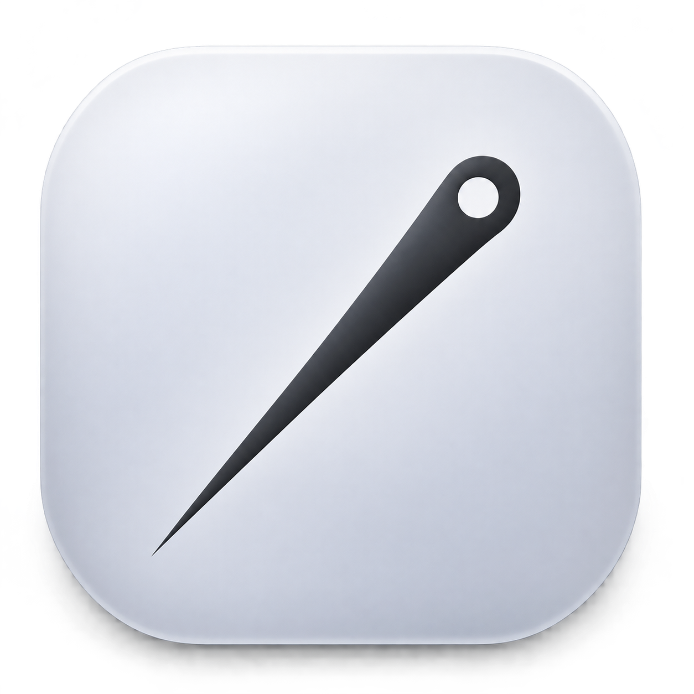

<p align="center">
  
</p>

# Needle

**Language / Dil:** [English](#needle) · [Türkçe](#türkçe)

Fast, private, local file search for macOS — inspired by voidtools Everything.

Needle builds its own index. It does not need an Everything installation, a
Windows machine, or any cloud service. Results update as you type.

## What it does

- **Its own persistent index.** File and folder names, full paths, size, and
  creation and modification dates are stored in SQLite at
  `~/Library/Application Support/Needle/index.sqlite`. Restarting the app does
  not trigger a full rescan.
- **Live search.** An in-memory n-gram index over names and paths keeps typing
  responsive, even while the first scan is still running. You never press Enter
  to search; results narrow with every keystroke.
- **Instant local updates.** FSEvents watches your local volumes, so a created,
  changed, deleted, or renamed file updates only its own record instead of
  forcing a rescan of the disk.
- **Network folders.** SMB and AFP mounts can be added as search roots. Because
  FSEvents is unreliable on network shares, network roots are reconciled on a
  schedule — daily at 02:00 by default, or when the Mac is idle, hourly, or
  every five minutes. Local disks keep their live FSEvents monitoring.
- **Optional Spotlight enrichment.** `mdfind` can fill in files that are missing
  from Needle's own index or that live on network volumes.
- **Everything-style query language.** `|`, `!`, groups, quoted phrases,
  wildcards, `ext:`, `path:`, `parent:`, `root:`, `file`, `folder`, `size:`,
  date filters, `content:`, `tag:`, `comment:`, `child:`, `empty:`, `dupe:`,
  `distinct:`, `count:`, `sort:`, the macros `audio:`, `image:`, `video:` and
  `zip:`, and character entities. `content:` also reads PDF text layers and
  recognizes text in common image formats with OCR.
- **EFU file lists.** Import voidtools-compatible `.efu` lists to index offline
  media, backups, or shares that are not currently mounted. Lists live in the
  index database and survive rescans. Results can be exported as EFU, CSV, or
  text.
- **Finder metadata.** Finder tags and comments are indexed for `tag:` and
  `comment:` searches, and can be edited in the Properties window.
- **Index journal.** Incremental changes, file-list imports and root changes are
  recorded in a bounded journal available from Settings and the app menu.
- **Thumbnail grid.** Switch between the detailed list and a Quick Look
  thumbnail grid without losing your selection or search state.
- **Per-root settings.** Each root can be disabled independently and can have
  its own additional exclusion paths.
- **Workflow features.** Saved searches, search and run history, advanced
  search, a properties panel, configurable columns, themes, Quick Look, Finder
  actions, a global hotkey, and an HTTP/JSON search server that is disabled by
  default. URLs such as `needle://search?q=report` open Needle and run a search,
  so browser bookmarks and Shortcuts can hand off queries. A native App Shortcut,
  “Search Needle”, is also registered for macOS Shortcuts and Siri.
- **Native macOS integration.** Drag folders onto the window to index them,
  drop an `.efu` list to import it, or drag results back to Finder for real file
  operations. Needle can also register as a login item from Settings.
- **Optional ETP endpoint.** A minimal loopback ETP/FTP control plane accepts
  `SITE EVERYTHING SEARCH/COUNT/OFFSET/QUERY` and column commands on port 8081
  by default, so Everything-compatible clients can query Needle. There is no
  data channel, TLS, or file download.
- **Privacy.** Indexing and searching happen entirely on your Mac. The HTTP and
  ETP servers bind only to `127.0.0.1` and have to be turned on explicitly.

Needle is inspired by Everything, but it is not fully binary-compatible with it.
The ETP endpoint implements the query control plane only; a few advanced
Everything features are not implemented — see [Scope](#scope) below.

## Requirements

- macOS 13 or newer
- Apple Silicon or Intel
- Xcode Command Line Tools (`xcode-select --install`) if you build from source

## Installation

The repository is <https://github.com/chnozmn-pixel/Needle>.

### 1. Release ZIP — recommended

1. Open the repository's **Releases** page.
2. Download `Needle-0.3.2.zip`.
3. Unzip it and move `Needle.app` into `/Applications`.
4. Launch it. On first run it indexes your home folder.

The released app is ad-hoc signed. If macOS blocks it, right-click the app and
choose **Open**, or approve it once under **System Settings → Privacy &
Security**. There is no installer and no background daemon.

### 2. Build from source with SwiftPM

This is the most auditable route: you compile exactly the code in the
repository.

```bash
git clone https://github.com/chnozmn-pixel/Needle.git
cd Needle
chmod +x scripts/*.sh
./scripts/build-app.sh
open dist/Needle.app
```

`scripts/build-app.sh` runs `swift build -c release`, assembles the `.app`
bundle, copies the icon and `Info.plist`, and ad-hoc signs the result. The
output is `dist/Needle.app`.

### 3. Homebrew Cask

A Cask definition lives at `Casks/needle.rb`, and its SHA-256 is refreshed from
`scripts/package-release.sh` for every release. Once the Cask is published in a
tap:

```bash
brew tap chnozmn-pixel/needle
brew install --cask needle
```

The Cask downloads the release ZIP, verifies its SHA-256, installs `Needle.app`
into `/Applications`, and defines a `zap` block that removes Needle's support
files when you uninstall it.

To test the Cask locally before publishing a tap:

```bash
brew install --cask ./Casks/needle.rb
```

### 4. Run from a checkout — for development

```bash
swift run Needle
```

This builds a debug binary against the same index database. It is meant for
development, not as a normal installation path.

### For maintainers: creating a release ZIP

```bash
./scripts/package-release.sh
# prints dist/Needle-0.3.2.zip and its SHA-256
```

Upload that ZIP to the GitHub release and copy the SHA-256 into the Cask.

## First run

- Needle indexes your home folder automatically. Add or remove roots under
  **Settings → Roots**.
- The bottom bar shows live scan progress and the number of indexed entries.
- `⌘⇧Space` brings the window forward, `⏎` opens the selected item, `⌘⏎` reveals
  it in Finder, `Space` opens Quick Look, and `⌘⇧C` copies paths.
- The interface is in English by default. Settings also offers the system
  language, plus Turkish, German, Spanish, French, Italian, Portuguese,
  Japanese, Simplified Chinese, Korean, Russian, Arabic, and Hindi. Switching
  takes effect immediately, and untranslated strings fall back to English.

## Search syntax

| Example | Meaning |
| --- | --- |
| `report` | Names containing "report" |
| `"annual report"` | Exact phrase |
| `apple \| pear` | Either term (OR) |
| `<apple pear> \| banana` | Group combined with OR |
| `!tmp` | Exclude anything matching "tmp" |
| `ext:pdf;docx` | PDF or DOCX files |
| `path:projects` | Match anywhere in the full path |
| `file size:>10mb` | Files larger than 10 MB |
| `dm:today` | Modified today |
| `content:needle` | Search file contents (PDF text and image OCR) |
| `tag:Important` | Finder tag |
| `comment:draft` | Finder comment |
| `dupe:size;content` | Duplicate files |
| `distinct:name` | Unique results only |

A space means AND, `|` means OR, and `!` means NOT. The full reference is in the
app under **Settings → Syntax**.

## Architecture

| Component | Responsibility |
| --- | --- |
| `FileSystem.scan` | Walks the selected roots with POSIX `opendir`/`readdir`/`lstat`, batches the metadata, and writes it to SQLite. |
| `IndexDatabase` | Persistent SQLite database in WAL mode, with incremental inserts, updates and deletes, EFU lists, root settings and the journal. |
| `SearchEngine` | In-memory snapshot with reversed 1-, 2-, and 3-byte n-gram posting lists; verifies real substring matches after intersecting candidates. |
| `FSEventsWatcher` | Live change stream for local volumes; only the affected records are updated. |
| `SpotlightSearch` | Optional `mdfind` lookups for missing entries and network volumes. |
| `IndexStore` / `IndexCoordinator` | Scan lifecycle, the network schedule, and published state for SwiftUI. |
| `NeedleApp` | SwiftUI interface, hotkeys, Quick Look, export, and settings. |
| `LocalizationManager` | Runtime language switching with an English fallback. |

Record IDs are 64-bit FNV-1a hashes of the normalized full path rather than
inodes, so they stay stable across network shares.

## Scope

Implemented: the persistent index, live search, FSEvents monitoring, scheduled
network roots, Spotlight enrichment, Everything-style query parsing, content and
duplicate search, EFU file-list import/export, Finder tag/comment search and
editing, the index journal, thumbnail grid, per-root settings, sorting, export,
the HTTP/JSON endpoint, localization, and the interface features listed above.
PDF text extraction and image OCR are available through `content:`.

Not implemented yet: ETP data-channel commands (FTP-style browsing and file
transfer), TLS, full Everything property parity, advanced index-location
settings, and the remaining details of custom sorting and configuration.
Contributions are welcome.

## Tests

```bash
swift test
```

The suite covers query parsing, n-gram search, incremental index updates,
advanced queries, the EFU codec and import path, journal and root-setting
persistence, tag/comment search, network scheduling state, the HTTP endpoints,
and the localization fallback and audit checks.

## Project layout

```
Sources/
  NeedleCore/    # index, SQLite, scanner, FSEvents, search engine, parser, localization
  NeedleApp/     # SwiftUI interface
  CSQLite/       # system sqlite3 module map
Tests/NeedleTests/
scripts/
  build-app.sh
  package-release.sh
Casks/needle.rb
Resources/Needle.icns
```

## License and credits

Needle is released under the [MIT License](LICENSE).

Sources and acknowledgements are listed in
[ACKNOWLEDGMENTS.md](ACKNOWLEDGMENTS.md). In short: thanks to voidtools for
documenting the search language that inspired this project, to Apple and the
SQLite project for the platform foundations, and to everyone who tested Needle
and reported issues.

---

<a id="türkçe"></a>

# Needle — Türkçe

macOS için voidtools Everything'den esinlenmiş, hızlı ve tamamen yerel çalışan
bir dosya arama uygulaması. [English](#needle)

Needle kendi indeksini oluşturur; Everything kurulumuna, Windows makinesine veya
herhangi bir bulut servisine ihtiyaç duymaz. Sonuçlar siz yazarken güncellenir.

## Ne işe yarar?

- **Kendi kalıcı indeksi var.** Dosya ve klasör adları, tam yollar, boyut,
  oluşturma ve değiştirme tarihleri şu konumdaki SQLite veritabanında tutulur:
  `~/Library/Application Support/Needle/index.sqlite`. Uygulamayı yeniden
  başlatmak baştan taramaya yol açmaz.
- **Canlı arama.** Adlar ve yollar üzerindeki bellek içi n-gram indeksi
  sayesinde, ilk tarama hâlâ sürerken bile yazmak akıcıdır. Arama için Enter'a
  basmanız gerekmez; sonuçlar her tuş vuruşunda daralır.
- **Yerel değişiklikler anında yansır.** FSEvents yerel diskleri izler; bir
  dosya oluşturulduğunda, değiştiğinde, silindiğinde veya adı değiştiğinde
  diskin tamamı yeniden taranmaz, yalnızca ilgili kayıt güncellenir.
- **Ağ klasörleri.** SMB ve AFP paylaşımları arama kökü olarak eklenebilir.
  FSEvents ağ paylaşımlarında güvenilir çalışmadığı için ağ kökleri bir
  zamanlamaya göre taranır: varsayılan olarak her gün 02:00'de, ya da Mac boşta
  kaldığında, saat başı veya beş dakikada bir. Yerel diskler canlı FSEvents
  izlemeyi sürdürür.
- **İsteğe bağlı Spotlight desteği.** Needle'ın kendi indeksinde bulunmayan veya
  ağ birimlerinde duran dosyalar `mdfind` ile tamamlanabilir.
- **Everything tarzı sorgu dili.** `|`, `!`, gruplar, tırnaklı ifadeler, joker
  karakterler, `ext:`, `path:`, `parent:`, `root:`, `file`, `folder`, `size:`,
  tarih filtreleri, `content:`, `tag:`, `comment:`, `child:`, `empty:`, `dupe:`,
  `distinct:`, `count:`, `sort:`, `audio:`, `image:`, `video:` ve `zip:`
  makroları ve karakter kısaltmaları. `content:` PDF metin katmanlarını okur,
  yaygın görsel biçimlerde OCR uygular.
- **EFU dosya listeleri.** voidtools uyumlu `.efu` listelerini içe aktararak
  çevrimdışı medyayı, yedekleri veya bağlı olmayan paylaşımları indekse
  ekleyebilirsiniz. Listeler veritabanında saklanır ve yeniden taramada korunur.
  Sonuçlar EFU, CSV veya metin olarak dışa aktarılabilir.
- **Finder metadata.** Finder etiketleri ve yorumları indekslenir; `tag:` ve
  `comment:` ile aranır, Özellikler penceresinden düzenlenir.
- **İndeks günlüğü.** Artımlı değişiklikler, dosya listesi içe aktarımları ve kök
  işlemleri sınırlı bir günlüğe yazılır; Ayarlar'dan ve uygulama menüsünden
  görüntülenir.
- **Küçük resim ızgarası.** Ayrıntılı liste ile Quick Look küçük resim ızgarası
  arasında, seçiminizi ve arama durumunuzu koruyarak geçiş yapabilirsiniz.
- **Kök başına ayarlar.** Her kök bağımsız olarak devre dışı bırakılabilir ve
  yalnızca o köke özel dışlama yolları eklenebilir.
- **İş akışı özellikleri.** Kayıtlı aramalar, arama ve çalıştırma geçmişi,
  gelişmiş arama, ayarlanabilir sütunlar, temalar, Quick Look, Finder işlemleri,
  genel kısayol tuşu ve varsayılan olarak kapalı gelen HTTP/JSON arama sunucusu.
  `needle://search?q=rapor` gibi URL'ler Needle'ı açıp aramayı çalıştırır; tarayıcı
  yer imleri ve Kısayollar bu şekilde sorgu aktarabilir. macOS Kısayollar ve Siri
  için “Search Needle” adlı yerel bir uygulama kısayolu da kaydedilir.
- **Yerel macOS entegrasyonu.** Klasörleri pencereye sürükleyerek indekse
  ekleyebilir, `.efu` listesini bırakıp içe aktarabilir veya sonuçları Finder'a
  sürükleyerek gerçek dosya işlemleri yapabilirsiniz. Ayarlar'dan açılışta
  başlatma öğesi olarak da kaydedilebilir.
- **İsteğe bağlı ETP uç noktası.** Minimal bir ETP/FTP kontrol düzlemi, varsayılan
  olarak 8081 portunda `SITE EVERYTHING SEARCH/COUNT/OFFSET/QUERY` ve sütun
  komutlarını kabul eder; Everything uyumlu istemciler Needle'ı sorgulayabilir.
  Veri kanalı, TLS veya dosya indirme yoktur.
- **Gizlilik.** İndeksleme ve arama tamamen sizin Mac'inizde yapılır. HTTP ve ETP
  sunucuları yalnızca `127.0.0.1` adresine bağlanır ve elle açılması gerekir.

Needle Everything'den esinlenmiştir, ancak tam ikili uyumlu değildir. ETP uç
noktası yalnızca sorgu kontrol düzlemini uygular; bazı gelişmiş Everything
özellikleri henüz yoktur; ayrıntı için aşağıdaki [Kapsam](#kapsam) bölümüne bakın.

## Gereksinimler

- macOS 13 veya üzeri
- Apple Silicon ya da Intel
- Kaynaktan derleyecekseniz Xcode Command Line Tools
  (`xcode-select --install`)

## Kurulum

Proje deposu: <https://github.com/chnozmn-pixel/Needle>

### 1. Release ZIP — önerilen yol

1. Deponun **Releases** sayfasını açın.
2. `Needle-0.3.2.zip` dosyasını indirin.
3. ZIP'i açın ve `Needle.app` uygulamasını `/Applications` klasörüne taşıyın.
4. Uygulamayı başlatın. İlk açılışta ev klasörünüz indekslenir.

Yayınlanan uygulama ad-hoc imzalıdır. macOS uygulamayı engellerse üzerine sağ
tıklayıp **Aç**'ı seçin veya **Sistem Ayarları → Gizlilik ve Güvenlik**
bölümünden bir kez onaylayın. Kurulum sihirbazı ve arka planda çalışan bir
servis yoktur.

### 2. SwiftPM ile kaynaktan derleme

Denetlenebilir en doğrudan yol: depodaki kodu olduğu gibi derlersiniz.

```bash
git clone https://github.com/chnozmn-pixel/Needle.git
cd Needle
chmod +x scripts/*.sh
./scripts/build-app.sh
open dist/Needle.app
```

`scripts/build-app.sh` komutu `swift build -c release` çalıştırır, `.app`
paketini oluşturur, simgeyi ve `Info.plist` dosyasını kopyalar ve sonucu ad-hoc
imzalar. Çıktı: `dist/Needle.app`.

### 3. Homebrew Cask

`Casks/needle.rb` dosyası bir Cask tanımı içerir; SHA-256 değeri her sürümde
`scripts/package-release.sh` çıktısına göre güncellenir. Cask bir tap üzerinden
yayınlandıktan sonra:

```bash
brew tap chnozmn-pixel/needle
brew install --cask needle
```

Cask, release ZIP'ini indirir, SHA-256 değerini doğrular, `Needle.app`
uygulamasını `/Applications` klasörüne kurar ve kaldırma sırasında Needle'ın
destek dosyalarını silen bir `zap` tanımı sağlar.

Tap yayınlamadan önce yerelde denemek için:

```bash
brew install --cask ./Casks/needle.rb
```

### 4. Depodan doğrudan çalıştırma — geliştirme için

```bash
swift run Needle
```

Bu komut hata ayıklama derlemesi üretir ve aynı indeks veritabanını kullanır.
Normal kurulum yolu değil, geliştirme içindir.

### Geliştiriciler için: release ZIP oluşturma

```bash
./scripts/package-release.sh
# dist/Needle-0.3.2.zip yolunu ve SHA-256 değerini yazdırır
```

Bu ZIP'i GitHub release'ine yükleyin ve SHA-256 değerini Cask dosyasına
kopyalayın.

## İlk açılış

- Needle ev klasörünüzü otomatik olarak indeksler. Kökleri **Ayarlar → Kökler**
  bölümünden ekleyip kaldırabilirsiniz.
- Alt çubuk canlı tarama ilerlemesini ve indekslenen kayıt sayısını gösterir.
- `⌘⇧Space` pencereyi öne getirir, `⏎` seçili öğeyi açar, `⌘⏎` öğeyi Finder'da
  gösterir, `Space` Quick Look'u açar, `⌘⇧C` yolları kopyalar.
- Arayüz varsayılan olarak İngilizcedir. Ayarlar'da sistem dilinin yanı sıra
  Türkçe, Almanca, İspanyolca, Fransızca, İtalyanca, Portekizce, Japonca,
  Basitleştirilmiş Çince, Korece, Rusça, Arapça ve Hintçe bulunur. Dil değişimi
  anında uygulanır; çevrilmemiş metinler İngilizce görünür.

## Arama sözdizimi

| Örnek | Anlamı |
| --- | --- |
| `report` | Adında "report" geçen öğeler |
| `"annual report"` | Tam ifade |
| `apple \| pear` | İki terimden biri (VEYA) |
| `<apple pear> \| banana` | Grup ile VEYA birleşimi |
| `!tmp` | "tmp" ile eşleşenleri hariç tut |
| `ext:pdf;docx` | PDF veya DOCX dosyaları |
| `path:projects` | Tam yolun herhangi bir yerinde eşleşme |
| `file size:>10mb` | 10 MB'tan büyük dosyalar |
| `dm:today` | Bugün değiştirilenler |
| `content:needle` | Dosya içeriğinde arama (PDF metni ve görsel OCR) |
| `tag:Önemli` | Finder etiketi |
| `comment:taslak` | Finder yorumu |
| `dupe:size;content` | Yinelenen dosyalar |
| `distinct:name` | Yalnızca tekil sonuçlar |

Boşluk VE, `|` VEYA, `!` ise DEĞİL anlamına gelir. Tam liste uygulama içinde
**Ayarlar → Sözdizimi** sekmesindedir.

## Mimari

| Bileşen | Görevi |
| --- | --- |
| `FileSystem.scan` | Seçilen kökleri POSIX `opendir`/`readdir`/`lstat` ile dolaşır, üst verileri toplu hâlde alır ve SQLite'a yazar. |
| `IndexDatabase` | WAL modunda çalışan kalıcı SQLite veritabanı; artımlı ekleme, güncelleme ve silme, EFU listeleri, kök ayarları ve günlük. |
| `SearchEngine` | Bellek içi anlık görüntü; ters çevrilmiş 1, 2 ve 3 baytlık n-gram listeleri ile aday kümesini daraltır, ardından gerçek eşleşmeyi doğrular. |
| `FSEventsWatcher` | Yerel diskler için canlı değişiklik akışı; yalnızca etkilenen kayıtlar güncellenir. |
| `SpotlightSearch` | Eksik kayıtlar ve ağ birimleri için isteğe bağlı `mdfind` sorguları. |
| `IndexStore` / `IndexCoordinator` | Tarama yaşam döngüsü, ağ zamanlaması ve SwiftUI'ya aktarılan durum bilgisi. |
| `NeedleApp` | SwiftUI arayüzü, kısayol tuşları, Quick Look, dışa aktarma ve ayarlar. |
| `LocalizationManager` | İngilizceye geri düşen, çalışma anında dil değiştirme. |

Kayıt kimlikleri inode yerine, normalleştirilmiş tam yolun 64 bitlik FNV-1a
özetidir; böylece ağ paylaşımlarında da kararlı kalır.

## Kapsam

Hazır olanlar: kalıcı indeks, canlı arama, FSEvents izleme, zamanlamalı ağ
kökleri, Spotlight desteği, Everything tarzı sorgu ayrıştırma, içerik ve
yinelenen dosya araması, EFU dosya listesi içe/dışa aktarma, Finder etiketi ve
yorumu arama/düzenleme, indeks günlüğü, küçük resim ızgarası, kök başına
ayarlar, sıralama, dışa aktarma, HTTP/JSON uç noktası, yerelleştirme ve yukarıda
sayılan arayüz özellikleri. `content:` PDF metin çıkarımı ve görsel OCR kullanır.

Henüz olmayanlar: ETP veri kanalı komutları (FTP tarzı gezinme ve dosya aktarımı),
TLS, Everything özellik uyumluluğunun tamamı, gelişmiş indeks konumu ayarları ve
özel sıralama ile yapılandırmanın kalan ayrıntıları. Katkılar memnuniyetle
karşılanır.

## Testler

```bash
swift test
```

Testler sorgu ayrıştırmayı, n-gram aramayı, artımlı indeks güncellemelerini,
gelişmiş sorguları, EFU kodlama/içe aktarmayı, günlük ve kök ayarı
kalıcılığını, etiket/yorum aramasını, ağ zamanlaması durumunu, HTTP uç
noktalarını ve yerelleştirme denetimlerini kapsar.

## Proje yapısı

```
Sources/
  NeedleCore/    # indeks, SQLite, tarayıcı, FSEvents, arama motoru, ayrıştırıcı, yerelleştirme
  NeedleApp/     # SwiftUI arayüzü
  CSQLite/       # sistem sqlite3 modül eşlemesi
Tests/NeedleTests/
scripts/
  build-app.sh
  package-release.sh
Casks/needle.rb
Resources/Needle.icns
```

## Lisans ve teşekkür

Needle [MIT Lisansı](LICENSE) ile yayınlanmaktadır.

Kaynaklar ve teşekkürler [ACKNOWLEDGMENTS.md](ACKNOWLEDGMENTS.md) dosyasında yer
alır. Kısaca: bu projeye ilham veren arama dilini belgelediği için voidtools'a,
platform altyapısı için Apple ve SQLite projelerine, uygulamayı deneyip hata
bildiren herkese teşekkürler.
